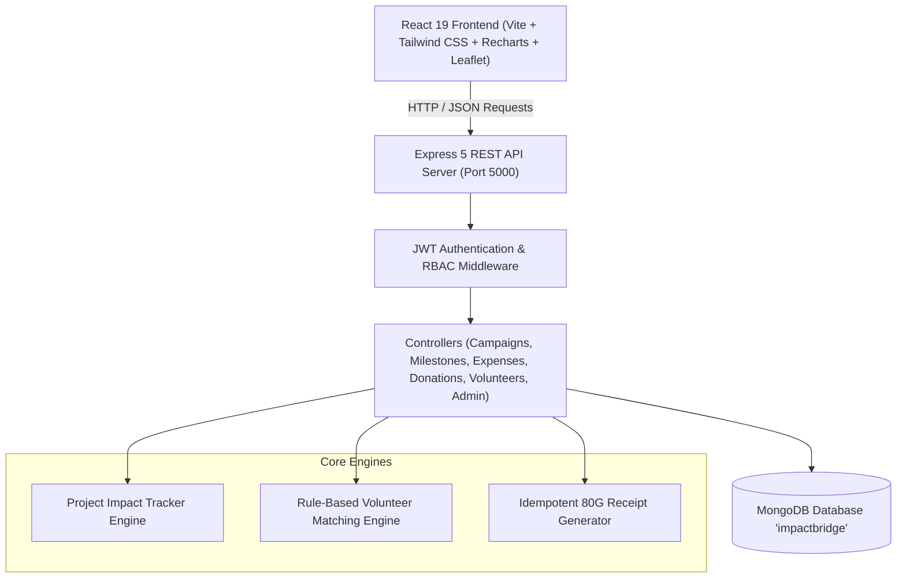
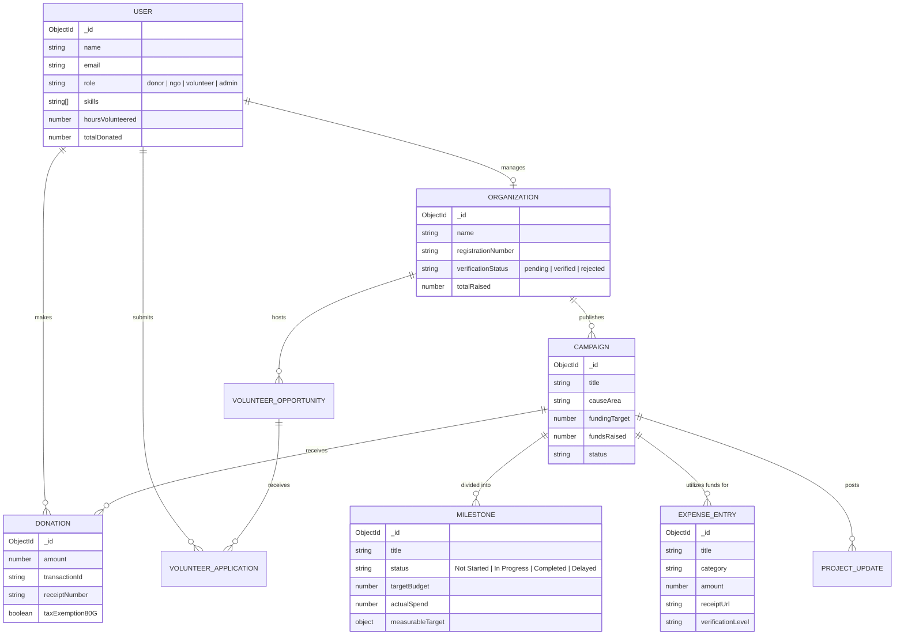

# ImpactBridge
> **Tagline:** *Give with purpose. Volunteer with impact. See the change.*

ImpactBridge is a full-stack MERN application that unifies NGO fundraising, skill-based volunteering, and real-time verifiable project impact tracking.

Instead of generic charity newsletters, ImpactBridge provides a signature **Project Impact Tracker**: donors follow the tangible growth of supported initiatives, verify phased milestones with photo/document proofs, inspect itemized budget allocations versus actual expenditures backed by vendor receipts, and download certified Section 80G tax exemption receipts.

---

## 🌟 Key Differentiating Features

1. **Signature Project Impact Tracker**
   - Funding progress (target vs. raised).
   - Milestone execution roadmap with measurable units (e.g. *12 of 12 solar plants active*).
   - Field evidence gallery with photos and signed testing reports.
   - Personalized donor impact spotlight (*"You contributed ₹25,000; 2 milestones reached since"*).

2. **Transparent Fund Utilization**
   - Planned budget categories vs. actual reported expenditure.
   - Interactive Recharts category comparison charts.
   - Itemized expense table with vendor names, receipt links, and verification levels (*NGO-Reported*, *Receipt Attached*, *Independently Audited*).

3. **Smart Volunteer Matching**
   - Transparent rule-based matching engine scoring opportunities (e.g., *95% Match*).
   - Explains match reasons based on skills, interests, and location/remote availability.
   - Complete application lifecycle: apply → NGO approves → attendance confirmed → verifiable service hours logged → certificate issued.

4. **Community Impact Map**
   - Interactive Leaflet & OpenStreetMap visualization.
   - Custom markers for active campaigns and volunteer hubs across cities.
   - Privacy protection for vulnerable beneficiary populations.

5. **Personal Impact Portfolio**
   - Combined dashboard showing total donations, verified volunteer hours, supported projects, and impact badges.
   - Printable Section 80G tax exemption receipts and Community Service Certificates.

6. **Evaluator One-Click Role Switcher**
   - Pinned top toolbar to immediately switch between **Donor (Alex)**, **NGO (Sunita)**, **Volunteer (Priya)**, and **Admin (Dr. Sarah)**.

---

## 🏛 System Architecture



---

## 🗄 Database Entity Relationship Diagram



---

## 🔑 Pre-Seeded Evaluation Accounts

| Role | Name | Email | Password | Key Data |
|---|---|---|---|---|
| **NGO Admin** | Sunita Rao | `greenearth@ngo.org` | `password123` | Green Earth Alliance (Verified 80G NGO) |
| **Donor** | Alex Morgan | `alex.donor@example.com` | `password123` | ₹45,000 Donated, 2 Active Projects |
| **Volunteer** | Priya Patel | `priya.volunteer@example.com` | `password123` | 24 Confirmed Hours, Teaching & First Aid |
| **Platform Admin**| Dr. Sarah Chen | `admin@impactbridge.org` | `password123` | Full Audit & Accreditation Rights |

*Tip: You can switch between any of these roles in 1 click using the top demo bar!*

---

## 🚀 Quickstart & Setup

### 1. Prerequisites
- **Node.js** (v18+)
- **MongoDB** running locally on `mongodb://localhost:27017` or MongoDB Atlas URI

### 2. Backend Setup
```bash
cd server
npm install
npm run seed     # Populates rich demo campaigns, milestones, expenses & users
npm run dev      # Runs Express API on http://localhost:5000
```

### 3. Frontend Setup
```bash
cd client
npm install
npm run dev      # Runs Vite app on http://localhost:3000
```

Open `http://localhost:3000` in your web browser.

---

## 🎯 5 Core Evaluation Workflows

1. **NGO Creates Campaign & Milestones**
   - Click **NGO (Sunita)** in top demo bar → Go to NGO Dashboard.
   - Click **New Campaign** or **+ Add Milestone** with measurable targets.
2. **Donor Contributes & Receives Instant 80G Receipt**
   - Click **Donor (Alex)** → Open *"Clean Drinking Water Barmer"* → Click **Contribute**.
   - Select ₹2,500 with Razorpay Sandbox simulation → Instant confetti & 80G tax receipt popup.
3. **Volunteer Discovers & Applies with Smart Match**
   - Click **Volunteer (Priya)** → Navigate to **Volunteer Hub**.
   - Notice the **Smart Match Score (e.g. 95% Match)** with skill alignment notes → Click **Apply**.
4. **NGO Logs Transparent Expense Voucher & Confirms Hours**
   - Click **NGO (Sunita)** → Log an expense of ₹45,000 under *Equipment* with receipt attachment.
   - Go to **Volunteer Applications** → Confirm Priya's hours → Official service certificate issued!
5. **Donor Opens Signature Impact Tracker**
   - Return to **Donor (Alex)** → Supported Projects → Open live Impact Tracker.
   - Inspect the updated funds progress, completed milestones, and itemized category expenditure chart.

     ---

## 🌐 Live Demo

**Try ImpactBridge here:** [Launch Live Website](https://impact-bridge-mu.vercel.app/)

Explore the platform's NGO fundraising, volunteer matching, and project impact tracking features through the live application.

